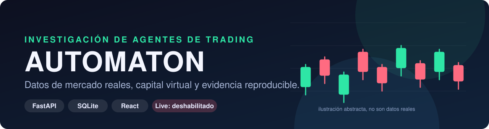
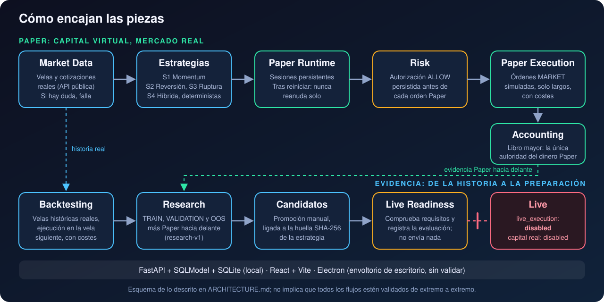
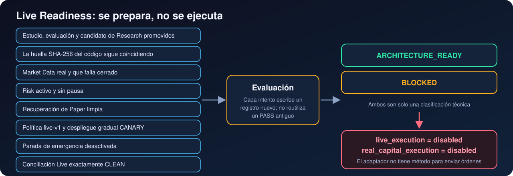

<div align="center">



<br>


**Plataforma local para desarrollar, probar y evaluar agentes autónomos de trading de criptomonedas**
usando datos de mercado reales y **capital virtual**. Es un laboratorio de investigación: no opera con dinero real.

[Qué hace](#qué-hace) ·
[Cómo funciona](#cómo-funciona) ·
[Estado](#estado-del-proyecto) ·
[Inicio rápido](#inicio-rápido) ·
[Límites](#límites-conocidos) ·
[Aviso](#aviso-importante)

</div>

---

> [!WARNING]
> **Este proyecto no es asesoramiento financiero ni un sistema para operar con dinero real.** No hay evidencia de
> rentabilidad en este repositorio, y ningún resultado de Backtest, Paper o Research debe interpretarse como una
> promesa de beneficios futuros. La ejecución real y el capital real están **deshabilitados por diseño**.

## Qué hace

| | |
|---|---|
| 📡 **Datos reales, sin inventar** | Velas y cotizaciones de la API pública de Binance, con validación de contratos (precios positivos, OHLC coherente, antigüedad, continuidad). Ante la duda, falla en lugar de rellenar. |
| 🧮 **Estrategias deterministas** | Cuatro reglas de referencia: S1 momentum, S2 reversión a la media, S3 ruptura y S4 híbrida. No hay LLM ni optimización automática. |
| 🧪 **Backtesting reproducible** | Conjuntos de datos históricos reales, ejecución en la vela siguiente, costes explícitos y huella SHA-256 del código de la estrategia. |
| 🧾 **Paper trading con contabilidad propia** | Órdenes MARKET simuladas, solo largas, siempre tras una autorización de Risk persistida; Accounting es la única fuente de verdad del dinero virtual. |
| 🔁 **Sesiones autónomas de Paper** | Sesiones persistentes que evalúan estrategias sobre velas, con recuperación tras reinicio (no reanudan solas) e idempotencia. |
| 🧬 **Ciclo de vida de agentes** | Aptitud (fitness), linaje y replicación manual que transfiere capital en lugar de duplicarlo. |
| 🔬 **Research con evidencia** | Estudios TRAIN → VALIDATION → OOS más evidencia de Paper hacia delante, y promoción manual de candidatos. Promover no significa rentable. |
| 🛑 **Live Readiness, sin Live** | Política, intents idempotentes, conciliación y parada de emergencia. El adaptador está deshabilitado y no puede enviar órdenes. |

**Para quién es:** para quien quiera estudiar cómo construir un sistema de trading auditable (contratos de datos,
separación de modos, idempotencia, recuperación) o experimentar con estrategias sin arriesgar capital.

## Cómo funciona



Las reglas de diseño que documenta [`ARCHITECTURE.md`](ARCHITECTURE.md) incluyen, entre otras:

- Backtest y Paper usan datos reales y capital virtual; los datos sintéticos solo se permiten en tests técnicos y nunca cuentan como evidencia.
- Toda ejecución Paper normal exige una decisión **ALLOW** de Risk persistida y vigente.
- Tras un reinicio, la actividad financiera dudosa **no se reanuda sola**.
- Research clasifica evidencia: no modifica estrategias, no las despliega y no activa Live.

### Live Readiness: preparar no es ejecutar



`ARCHITECTURE_READY` es solo una clasificación técnica. Los límites de `live-v1` (por ejemplo 100 $ de capital
desplegable y 25 $ por orden, con un 10 % en la fase `CANARY`) son puertas de diseño, **no capital autorizado**.
No existe ninguna ruta para enviar órdenes, escribir credenciales ni activar capital real.

## Estado del proyecto

Resumen honesto, basado en la auditoría realizada sobre el commit `72daae1` (30 de septiembre de 2026) en un entorno
aislado. No es una certificación.

| Pieza | Estado | Nota |
|---|:---:|---|
| Contratos de Market Data y proveedor público | ✅ | 13 tests aprobados con transporte HTTP simulado; no se probó contra el servicio real. |
| Estrategias S1–S4 | 🟡 | Implementadas; 2 tests fallan por contradicciones entre el test y los datos/contrato, no por un fallo demostrado de ejecución. |
| Accounting | 🟡 | Invariantes cubiertas por tests (11 aprobados en la selección auditada). |
| Risk → Paper Execution | 🚧 | **Defecto reproducido:** la fecha de la cotización persistida pierde su zona horaria (UTC) y Paper rechaza la orden al compararla. Bloquea el flujo feliz. |
| Backtesting | 🟡 | Diseño sólido; 20 de 23 tests aprobados. Detectado que no se descartan velas aún abiertas y que la huella del dataset no se reverifica al ejecutar. |
| Paper Runtime (sesiones) | 🟡 | Recuperación e idempotencia con tests; depende del flujo Risk → Paper y no se probó un funcionamiento prolongado. |
| Research y evolución de agentes | 🟡 | Con tests; sus caminos positivos usan datos parcialmente simulados. |
| Live Readiness | 🟡 | Barreras y adaptador deshabilitado cubiertos por tests y guardas estáticas, que no son una garantía universal de seguridad. |
| Arranque con base de datos nueva | 🚧 | **Falla** en el entorno de auditoría (error de sesión SQLAlchemy antes de aceptar peticiones). |
| Frontend (React) | 🚧 | `npm run build` falla en una instalación aislada: `axios` no está declarado en `frontend/package.json`. |
| Electron | 🚧 | Revisado solo estáticamente; sin distribución de escritorio demostrada. |

✅ probado · 🟡 implementado, pendiente de validar · 🚧 en construcción o con defectos conocidos.

Suite completa del backend en la auditoría: **225 tests, 204 aprobados y 21 fallidos**. Los fallos se agrupan en pocas
causas (ver arriba) y no se han corregido en este repositorio.

## Inicio rápido

> [!NOTE]
> Dado el estado descrito arriba, **no se garantiza que el proyecto arranque ni compile sin ajustes**. Estos son
> los comandos que declaran `package.json`, el `Makefile` y la integración continua.

Requisitos: **Python 3.11**, **Node.js** (la CI usa la versión 20) y npm.

```bash
npm run setup        # instala dependencias raíz, frontend y Electron, y las del backend (pip)
npm run dev          # backend (127.0.0.1:8000) + frontend (localhost:5173) + Electron
```

También hay un lanzador para Windows (`AUTOMATON.bat`) que ejecuta `npm run dev`.

Pruebas y compilación:

```bash
cd backend && pytest tests/ -v
cd frontend && npm test
cd frontend && npm run build
```

Es una aplicación **local**: el script `npm run dev` enlaza el backend a `127.0.0.1`, y los endpoints de Live
Readiness no añaden autenticación propia, así que no la expongas a internet ni a otros usuarios.

<details>
<summary><b>API principal (prefijos de ruta)</b></summary>

| Prefijo | Dominio |
|---|---|
| `/api/market-data` | Cotizaciones y velas reales |
| `/api/accounting` | Contabilidad de Paper |
| `/api/risk` | Perfil y decisiones de riesgo |
| `/api/paper` | Ejecución Paper |
| `/api/backtests` | Conjuntos de datos y ejecuciones históricas |
| `/api/evolution` | Aptitud, linaje y replicación |
| `/api/runtime` | Sesiones autónomas de Paper |
| `/api/research` | Estudios y candidatos |
| `/api/live` | Estado de Live Readiness (lectura, evaluación, parada de emergencia y conciliación) |
| `/api/agents`, `/api/trades`, `/api/crypto` | Agentes, operaciones y datos de apoyo |

Hay además `/health` y `/api/estado`, que devuelven etiquetas de modo fijas y **no certifican** que el proveedor o el
libro contable funcionen.

</details>

<details>
<summary><b>Las cuatro estrategias de referencia</b></summary>

- **S1 Momentum:** compra si los tres últimos precios suben de forma consecutiva; si no, mantiene.
- **S2 Reversión a la media:** con los últimos 20 precios, compra por debajo del 98 % de la media y vende por encima del 102 %.
- **S3 Ruptura:** compra si el precio actual supera el máximo de los 10 precios anteriores.
- **S4 Híbrida:** combinación determinista; exige al menos dos señales de compra.

Son líneas base para investigar, no recomendaciones. Los porcentajes de rendimiento de documentos históricos del
repositorio no están reproducidos y no deben tomarse como hechos.

</details>

## Configuración

No se necesitan claves para el uso previsto (datos públicos y capital virtual). [`.env.example`](.env.example) solo
documenta `FRONTEND_URL` (por defecto `http://localhost:5173`) para Electron. **No guardes credenciales de ningún
exchange**: el proyecto no tiene ruta de escritura de credenciales.

## Límites conocidos

- **Sin evidencia de rentabilidad.** Nada en el repositorio demuestra que alguna estrategia gane dinero.
- **Live deshabilitado a propósito.** Activar capital real exigiría un adaptador de exchange auditado, gestión de secretos y una decisión explícita ajena a este código.
- **Los defectos de la tabla de estado siguen abiertos** (zona horaria en Risk/Paper, arranque con base nueva, `axios` en el frontend, velas abiertas en Backtesting).
- Sin autenticación ni autorización en los endpoints; pensado para uso local de un solo usuario.
- La ruta de la base de datos SQLite es relativa al directorio de trabajo; el scheduler no demuestra exclusión entre varios procesos.
- Sin pruebas de funcionamiento prolongado ni contra servicios reales.
- Los documentos históricos (`CHANGELOG`, planes antiguos, `.docx` de estrategias) incluyen afirmaciones obsoletas; la fuente vigente es [`ARCHITECTURE.md`](ARCHITECTURE.md) y [`docs/PRODUCT_CONTRACT.md`](docs/PRODUCT_CONTRACT.md).

## Estructura del proyecto

```
backend/app/
  market_data/       contratos de Quote/Candle, proveedor público y controles de calidad
  services/          estrategias S1–S4
  risk/              autorización obligatoria antes de cada orden Paper
  paper_execution/   órdenes simuladas
  accounting/        libro mayor y posiciones del capital virtual
  paper_runtime/     sesiones autónomas, ciclos y scheduler
  backtesting/       datasets históricos, ejecución y métricas
  agent_evolution/   aptitud, linaje y replicación
  strategy_research/ estudios, evaluación y promoción de candidatos
  live_execution/    Live Readiness (adaptador deshabilitado)
backend/tests/       suite de pytest
frontend/            React + Vite (Dashboard, mercado, monitor, agentes, ajustes)
electron/            envoltorio de escritorio
docs/                contrato de producto, arquitectura de datos y notas históricas
```

## Documentación

- [`ARCHITECTURE.md`](ARCHITECTURE.md): límites no negociables y dominios activos.
- [`docs/PRODUCT_CONTRACT.md`](docs/PRODUCT_CONTRACT.md): modos de operación y reglas de veracidad.
- [`docs/LIVE_TRADING_GATE.md`](docs/LIVE_TRADING_GATE.md): qué implica (y qué no) la preparación para Live.
- [`docs/STRATEGIES.md`](docs/STRATEGIES.md): estrategias y modelo de estados de evidencia.
- [`docs/RISK_MANAGEMENT.md`](docs/RISK_MANAGEMENT.md), [`docs/PAPER_TRADING.md`](docs/PAPER_TRADING.md), [`docs/BACKTESTING.md`](docs/BACKTESTING.md).

El repositorio no incluye un archivo de licencia, así que no se concede ninguna licencia de uso por defecto.

---

## Aviso importante

<div align="center">

<sub>Proyecto personal de investigación y aprendizaje. No es asesoramiento financiero, de inversión ni fiscal, y no está
afiliado a ningún exchange. El trading de criptomonedas conlleva un riesgo alto de pérdida; no uses este software
con dinero real. Los resultados simulados no garantizan resultados futuros.</sub>

</div>
